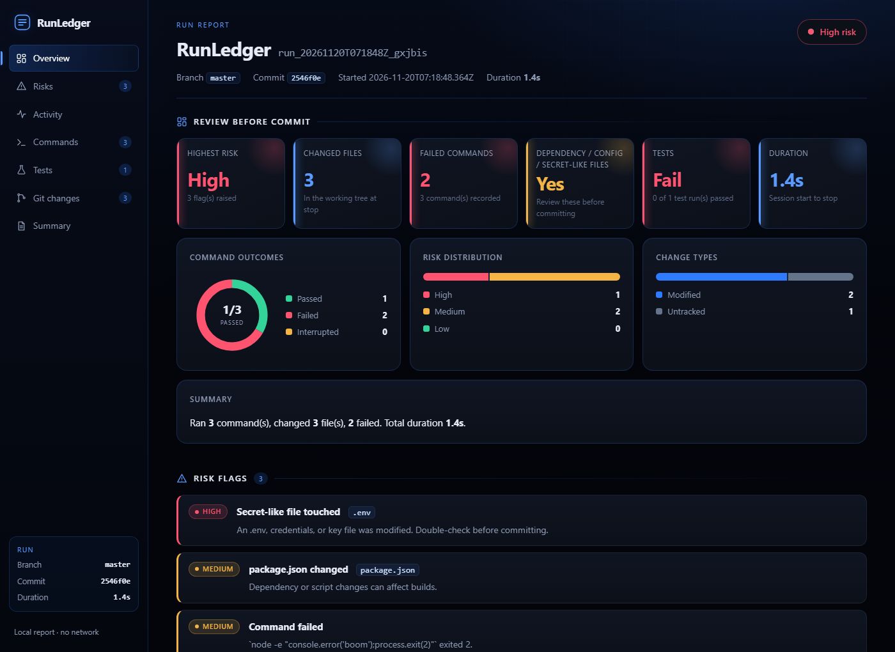

<div align="center">

# RunLedger

**Audit reports for AI coding-agent sessions.**


[Live Demo](https://runledger-web.vercel.app/)

</div>

RunLedger records what an AI coding agent did (every command, changed file and risky edit) and turns it into one HTML report you can review before committing. Everything stays local.

<p align="center">
  
</p>

## Features

- Automatic recording for Claude Code sessions
- Commands with output, duration and exit code
- Git changes and full diff
- Risk flags for secrets, dependencies, CI config and failures

## Install

```bash
git clone https://github.com/Vijaypn87/RunLedger.git
cd RunLedger
npm install && npm run build && npm link
```

## Usage

```bash
runledger hooks install     # record Claude Code sessions automatically
```

Or record manually:

```bash
runledger start
runledger run -- npm test
runledger stop
runledger open <run-id>
```

## License

MIT
