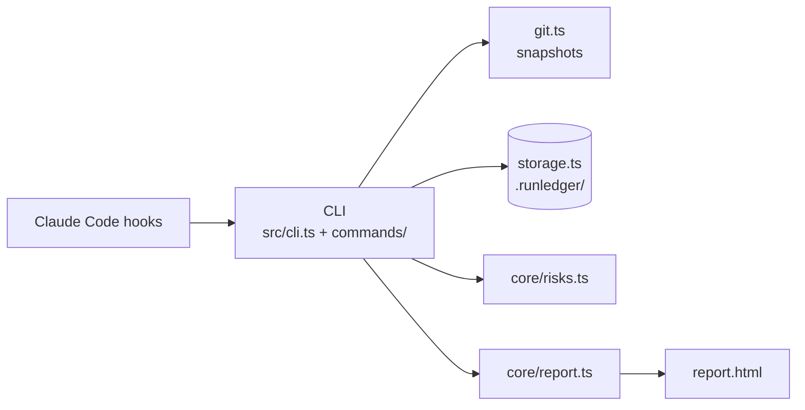

<div align="center">

# RunLedger

**Every run, on the record.**

Local-first audit reports for AI coding-agent sessions.

[](#-testing)
[](https://nodejs.org)
[](./tsconfig.json)
[](./LICENSE)

[**Live Demo**](https://runledger-web.vercel.app/) &nbsp;·&nbsp; [**Quick start**](#-installation)

</div>

---

## ◆ Tech stack


## ◆ About

AI coding agents edit dozens of files, run commands, hit failures and retry, then hand back a "done." RunLedger records the session and writes one self-contained HTML report: every command, every changed file, every risky edit. No cloud, no telemetry; everything stays in `.runledger/` in your project.

## ◆ Features

- **Automatic recording** for Claude Code sessions through its hooks
- **Command tracking:** output, duration and exit code for every command
- **Git changes:** files changed during the session and the full diff
- **Risk flags:** secret files, dependencies, CI config, migrations, deletions, failed commands
- **HTML report** with charts, filters and a Markdown summary for PRs

<p align="center">
  
</p>

## ◆ Installation

Requires Node.js 18+.

```bash
git clone https://github.com/Vijaypn87/RunLedger.git
cd RunLedger
npm install
npm run build
npm link
```

## ◆ Usage

**With Claude Code (automatic):**

```bash
runledger hooks install     # once per project
```

Every Claude Code session is then recorded, and the report is written when the session ends.

**Manual:**

```bash
runledger start             # begin recording
runledger run -- npm test   # run and record a command
runledger stop              # finalize and write the report
runledger list              # past runs
runledger open <run-id>     # open a report
```

## ◆ Architecture



Full design: [`docs/spec.md`](docs/spec.md).

## ◆ Testing

```bash
npm test
```

## ◆ Roadmap

- [ ] Support more agents (Cursor, Aider)
- [ ] Configurable risk rules per project
- [ ] Parse test output into per-test results
- [ ] Publish to npm
