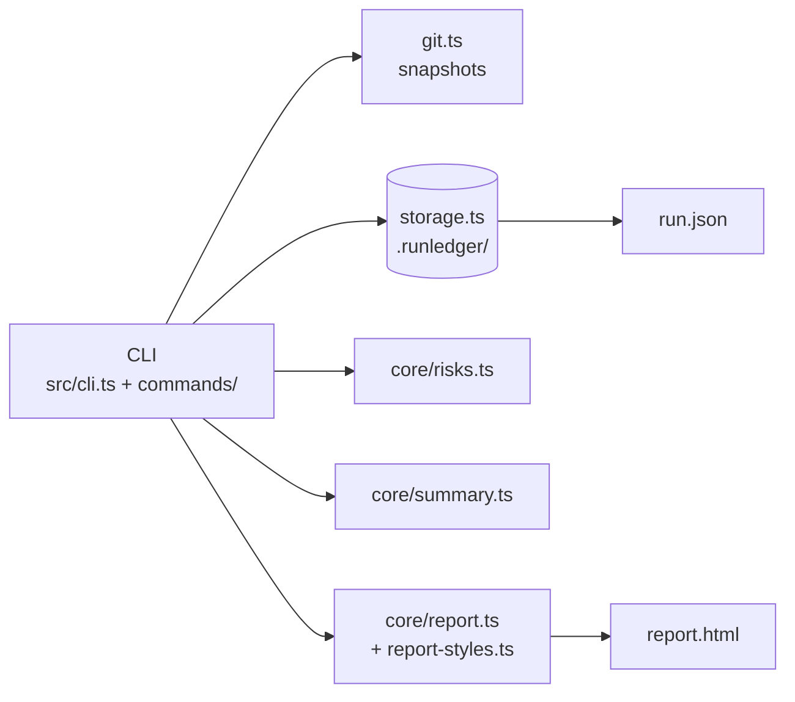

<div align="center">

# RunLedger

**Every run, on the record.**

Local-first audit reports for AI coding-agent sessions.

[](#-testing)
[](https://nodejs.org)
[](./tsconfig.json)
[](./LICENSE)

[**Live Demo**](https://runledger-web.vercel.app/) &nbsp;·&nbsp; [**GitHub**](https://github.com/Vijaypn87/RunLedger) &nbsp;·&nbsp; [**Quick start**](#-installation)

</div>

---

## ◆ About

AI coding agents are productive and opaque. They edit dozens of files, run scripts, hit failures, retry, and hand back a "done." Reviewing that means scrolling a chat transcript and reconciling it with `git status`.

RunLedger records the session from your terminal and writes one self-contained HTML report: every command, every changed file, every risky touch. No cloud, no backend, no telemetry. Everything lives in a `.runledger/` folder in your project.

## ◆ Key features

| ● **Session recording** | ▸ **Command tracking** | ⑂ **Git change tracking** |
| :-- | :-- | :-- |
| `start` / `stop` bracket a session and snapshot git state at both ends. The active session survives a crash. | `run -- <cmd>` executes through your shell, streams output live, and records exit code, duration and a 4 KB head and tail of stdout and stderr. | Files changed during the session (already-dirty files left untouched are excluded), `git diff --stat` and the full diff against `HEAD`, staged or not. Diffs over 256 KB are stored as head and tail with a truncation marker. |

| ⚠ **Risk detection** | ✓ **Test command tracking** | ▤ **HTML audit report** |
| :-- | :-- | :-- |
| Flags secret-like files, `package.json` and lockfiles, CI config, migrations, deletions, large diffs and failed commands. | Commands that look like test runs (`npm test`, `vitest`, `pytest`, `cargo test`, `go test`, …) get their own section with pass/fail by exit code. | A dark, responsive dashboard with an activity log, charts, filterable commands and a colour-coded diff. No external requests. |

**Activity summaries:** every run also produces a Markdown summary you can copy into a PR description.

> **Limits:** test tracking reads the command text and exit code only; individual test cases are not parsed. Without a git repository, commands are still recorded but file and diff sections show an empty state.

## ◆ Dashboard preview

<p align="center">
  
</p>

<sub>Generated by RunLedger from a short scratch session in a throwaway git repo.</sub>

## ◆ Tech stack


One runtime dependency (`commander`); the report is plain generated HTML with inline CSS and JS.

## ◆ Architecture



- **`src/commands/`:** one thin file per CLI command.
- **`src/core/`:** pure functions over the `RunLedgerRun` data model (risk rules, Markdown summary, HTML report); `storage.ts` does atomic JSON writes.
- **`src/git.ts`:** the only module that shells out to `git`.
- **Storage:** `.runledger/active.json` while recording, then `.runledger/runs/<id>/run.json` and `report.html` on `stop`.

Full design: [`docs/spec.md`](docs/spec.md).

## ◆ Installation

Requires Node.js 18 or newer. RunLedger is not published to npm yet; install from source:

```bash
git clone https://github.com/Vijaypn87/RunLedger.git
cd RunLedger
npm install
npm run build
npm link            # makes the `runledger` command available
```

RunLedger writes a `.gitignore` inside `.runledger/`, so recordings (which can contain command output and diffs) are never committed.

## ◆ Usage

```bash
runledger init                      # one-time per project
runledger start                     # begin recording
runledger run -- npm test           # run and record a command
runledger run -- npm run build
runledger stop                      # finalize: git snapshot, risks, report
runledger list                      # past runs, newest first
runledger report                    # regenerate the latest report
runledger open <run-id>             # open a report in your browser
runledger status                    # live state of the active session
```

`runledger run -- <cmd>` executes through your shell (`/bin/sh -c` on Unix, `cmd.exe` on Windows) and exits with the command's own exit code. Arguments keep their quoting (`runledger run -- echo "a b"` passes `a b` as one argument); to use shell operators, pass one quoted string: `runledger run -- "npm test && npm run build"`. Ctrl-C stops the command and it is still recorded.

Sample output of `runledger stop`:

```text
✓ RunLedger run finalized.
  Run id: run_20261120T071848Z_gxjbis
  Report: /path/to/project/.runledger/runs/run_20261120T071848Z_gxjbis/report.html
  Open it: runledger open run_20261120T071848Z_gxjbis
```

### Automatic recording with Claude Code

Skip `start`, `run` and `stop` entirely: let Claude Code's hooks drive RunLedger.

```bash
runledger hooks install             # in your project; writes .claude/settings.local.json
```

From then on every Claude Code session in that project is recorded:

| Claude Code event | RunLedger does |
| :-- | :-- |
| `SessionStart` | starts a run (a resumed session keeps the open run) |
| `PostToolUse` / `PostToolUseFailure` (Bash) | records the command, output, duration and exit code |
| `SessionEnd` | finalizes the run and writes the report |

Use `--shared` to write `.claude/settings.json` instead (committed, so teammates need RunLedger installed). `runledger hooks uninstall` removes only RunLedger's entries. The hook never blocks or fails the agent: on any error it logs to stderr and exits 0.

## ◆ Testing

```bash
npm test            # 68 tests across 9 files
npm run build
npm run typecheck
```

Covers risk rules, storage round-trips, Markdown summary, time formatting and report rendering (empty states, escaping, truncated diffs, dashboard helpers).

## ◆ Roadmap

- [ ] Filter and search across runs
- [ ] Per-agent attribution (Claude, Cursor, Aider, custom)
- [ ] Auto-record without an explicit `start` (shell hook integration)
- [ ] Configurable risk rules per project
- [ ] Parse test-runner output into per-test results
- [ ] Publish to npm
